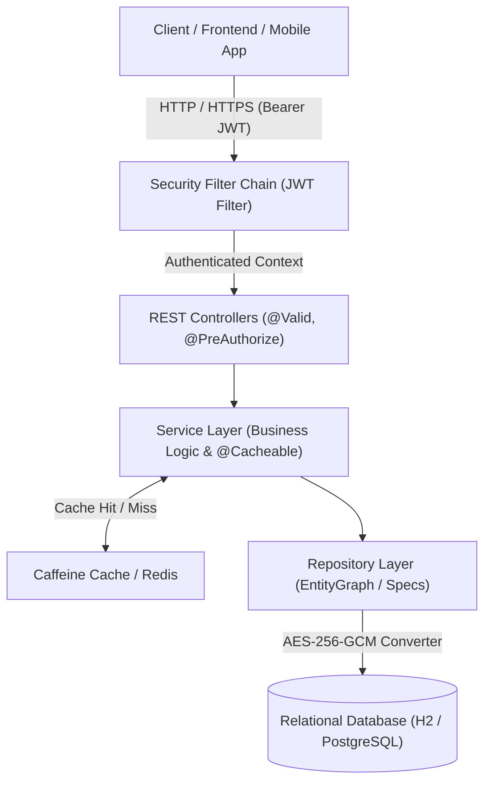

# Enterprise RESTful API Platform (Spring Boot 3 & Java 21)

[](https://openjdk.org/)
[](https://spring.io/projects/spring-boot)
[](https://spring.io/projects/spring-security)
[](LICENSE)

A production-ready enterprise RESTful backend architecture built with **Spring Boot 3**, **Java 21**, **Spring Security 6**, and **JPA/Hibernate**. Designed to serve as a high-scalability blueprint with enterprise-grade validation, standardized response envelopes, field-level AES-256-GCM encryption, JWT role-based access control (RBAC), multi-level caching, and N+1 query elimination.

---

## 🌟 Key Features & Architectural Pillars

### 1. Robust Validation & RFC-7807 Error Envelopes
- Strict input validation via `jakarta.validation` (`@NotNull`, `@NotBlank`, `@Email`, `@Size`, regex patterns).
- Uniform RFC-7807 compliant error envelopes (`ErrorResponse`) capturing field validation maps, error classifications, timestamps, and request paths.
- Centralized `@RestControllerAdvice` mapping domain exceptions (`ResourceNotFoundException`, `DuplicateResourceException`, `TokenRefreshException`, `AccessDeniedException`).

### 2. Standardized Response Wrapping
- Every successful API response is packaged in a predictable, strongly-typed envelope:
  ```json
  {
    "success": true,
    "statusCode": 200,
    "message": "Customer retrieved successfully",
    "data": { ... },
    "timestamp": "2026-10-28T10:45:00.000Z"
  }
  ```

### 3. Scalable Pagination, Sorting & Dynamic Filtering
- Spring Data JPA `Pageable` and `Sort` parameters across all query endpoints.
- Dynamic multi-criteria querying through `JpaSpecificationExecutor` and Criteria API (keyword search, status filters, date ranges, balance bounds).
- Custom `PagedResponse<T>` metadata envelope with page size, current page, total elements, total pages, and navigation flags.

### 4. Read Optimization & Query Strategies
- **In-Memory Caffeine Caching**: Sub-millisecond response times for frequent reads (`@Cacheable(value = "customers", key = "#id")`).
- **Atomic Cache Invalidation**: Automatic cache eviction (`@CacheEvict`) on entity update and deletion.
- **N+1 Problem Elimination**: Spring Data JPA `@EntityGraph(attributePaths = {"accounts"})` and explicit JPQL `JOIN FETCH` queries eliminate N+1 latency penalty.
- **Batch Processing**: Configured `default_batch_fetch_size: 25` and JDBC batching (`batch_size: 30`).
- **Targeted Database Indexing**: Strategic compound and single-column indexes on high-cardinality search columns (`email`, `status`, `created_at`, `account_number`).

### 5. Enterprise Security & JWT Role-Based Access Control (RBAC)
- Stateless session management (`SessionCreationPolicy.STATELESS`).
- Cryptographically signed HMAC-SHA256 JWT access and refresh tokens.
- Method-level role authorization (`@PreAuthorize("hasRole('ADMIN')")`, `@PreAuthorize("hasAnyRole('MANAGER', 'ADMIN')")`).
- Custom `JwtAuthenticationEntryPoint` (401) and `CustomAccessDeniedHandler` (403) providing JSON error envelopes instead of raw HTML error pages.

### 6. Sensitive Data Encryption & Secure Storage
- **AES-256-GCM (AEAD)** Field-Level Encryption: Sensitive customer identifiers (Tax ID / SSN, Phone number) are transparently encrypted before database insertion and decrypted on fetch using a JPA `AttributeConverter`.
- **Tamper-Proof Authentication Tags**: 128-bit authentication tag and dynamic 96-bit initialization vectors (IV) prevent chosen-ciphertext attacks and padding oracle exploits.
- **BCrypt Password Hashing**: Passwords stored using adaptive salted BCrypt hashing with work factor 12.
- **Output Masking**: Sensitive fields are automatically masked in DTO responses (e.g., `****-**-4321`) to prevent accidental data leakage to frontends.

---

## 🏛️ Architecture Overview



---

## 📋 Pre-Seeded Demonstration Accounts

For immediate local verification, the application automatically seeds the following credentials:

| Role | Email | Password | Allowed Capabilities |
| :--- | :--- | :--- | :--- |
| **Admin** | `admin@enterprise.com` | `Admin@12345` | Full administrative control (CRUD, delete, role assignment) |
| **Manager** | `manager@enterprise.com` | `Manager@12345` | Customer creation, updates, and account querying |
| **User** | `user@enterprise.com` | `User@12345` | Read customer profiles and personal accounts |

---

## 🚀 Getting Started

### Prerequisites
- **Java 21** or later
- **Maven 3.8+** (or use included commands)
- **Docker & Docker Compose** (optional, for PostgreSQL containerized setup)

### Option 1: Run Locally (Default H2 In-Memory)
```bash
# Clone the repository
git clone https://github.com/your-username/spring-enterprise-rest-api.git
cd spring-enterprise-rest-api

# Compile and run
mvn clean spring-boot:run
```
The application will launch on **http://localhost:8080**.

### Option 2: Run with Docker Compose (PostgreSQL)
```bash
docker-compose up --build
```

---

## 📖 Interactive API Documentation

When the application is running, explore and test the endpoints interactively via Swagger UI:
- **Swagger UI**: [http://localhost:8080/swagger-ui.html](http://localhost:8080/swagger-ui.html)
- **OpenAPI 3.0 Docs**: [http://localhost:8080/v3/api-docs](http://localhost:8080/v3/api-docs)
- **H2 Console**: [http://localhost:8080/h2-console](http://localhost:8080/h2-console) (JDBC URL: `jdbc:h2:mem:enterprisedb`, User: `sa`, Password: empty)

---

## 🔌 API Endpoints Summary

### Authentication (`/api/v1/auth`)
| Method | Endpoint | Access | Description |
| :--- | :--- | :--- | :--- |
| `POST` | `/api/v1/auth/register` | Public | Register new user with password validation |
| `POST` | `/api/v1/auth/login` | Public | Authenticate and obtain JWT access & refresh tokens |
| `POST` | `/api/v1/auth/refresh-token`| Public | Exchange refresh token for new access token |
| `GET` | `/api/v1/auth/me` | Authenticated | Retrieve current authenticated user profile |

### Customer Management (`/api/v1/customers`)
| Method | Endpoint | Access | Description |
| :--- | :--- | :--- | :--- |
| `POST` | `/api/v1/customers` | Admin, Manager | Create customer (Tax ID and phone encrypted at rest) |
| `GET` | `/api/v1/customers/{id}` | All Roles | Read customer with Caffeine caching & N+1 elimination |
| `GET` | `/api/v1/customers` | All Roles | Paginated & sortable search with dynamic filtering |
| `PUT` | `/api/v1/customers/{id}` | Admin, Manager | Update customer and invalidate cache |
| `DELETE` | `/api/v1/customers/{id}` | Admin only | Delete customer record and purge cache |

### Financial Accounts (`/api/v1/accounts`)
| Method | Endpoint | Access | Description |
| :--- | :--- | :--- | :--- |
| `POST` | `/api/v1/accounts` | Admin, Manager | Open new account attached to a customer |
| `GET` | `/api/v1/accounts/{id}` | All Roles | Query account details with eager customer fetch |
| `GET` | `/api/v1/accounts/customer/{id}` | All Roles | List all accounts for a specific customer |

---

## 🧪 Testing

Execute automated unit and integration tests:
```bash
mvn clean test
```

---

## 📦 How to Push to GitHub

```bash
# Initialize git repository
git init

# Add all files
git add .

# Commit changes
git commit -m "feat: initial commit of production-ready enterprise REST API"

# Add your GitHub repository remote
git branch -M main
git remote add origin https://github.com/<YOUR-GITHUB-USERNAME>/spring-enterprise-rest-api.git

# Push to GitHub
git push -u origin main
```

---

## 📄 License
This project is licensed under the [Apache License 2.0](LICENSE).
